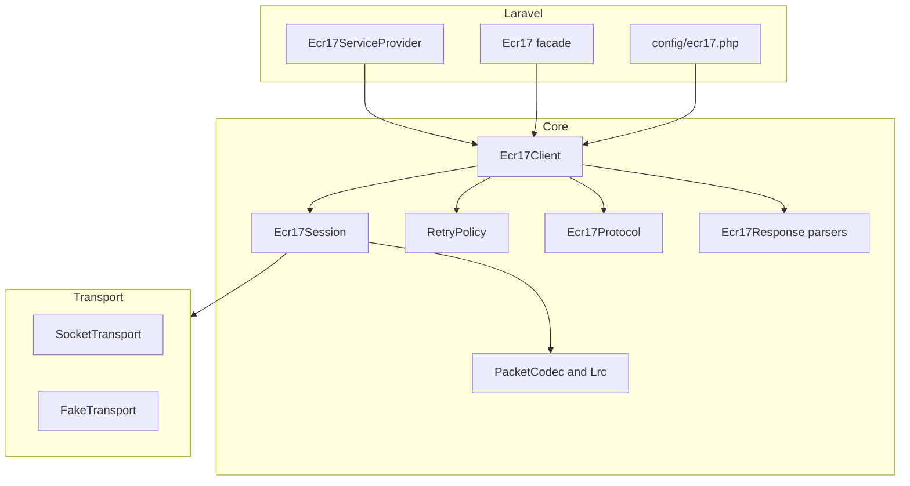

# Architecture Overview

The architecture keeps Laravel integration thin and isolates protocol behavior in framework-free PHP classes.

::: callout info "Design rule"
`Ecr17Client` decides command semantics; `Ecr17Session` drives one exchange; `PacketCodec` handles bytes; response classes expose domain fields.
:::

## Limits

The package does not provide persistence, order state machines, or a hosted terminal simulator. Applications must own those boundaries.
