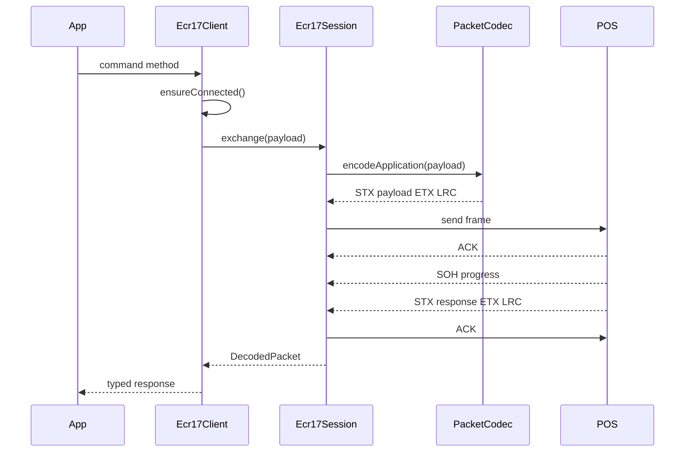

# Pipeline Workflow

## Design

## Workflow notes

::: steps
1. Build the application payload with `Ecr17Protocol`.
2. Encode it as a physical frame with `PacketCodec`.
3. Complete the ACK/NAK handshake.
4. Stream progress and receipt callbacks.
5. Validate the final application frame LRC.
6. Parse the payload into a typed response object.
:::

::: callout warning "Gotcha"
An application result may arrive before a physical ACK. The session stores that pending result and returns it through the normal result path instead of dropping it.
:::
