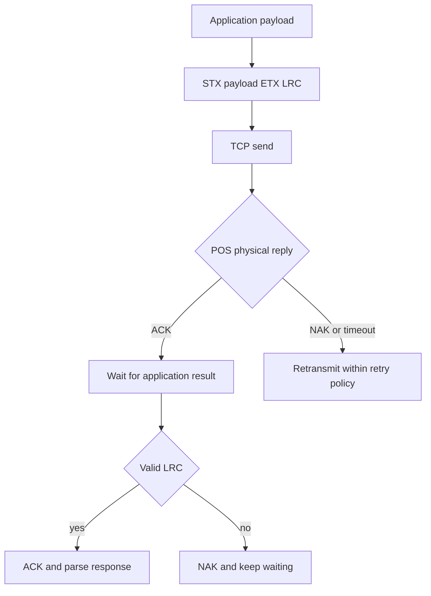

# Teoria

ECR17 separates a framed physical transport layer from application messages. The package models that split through `PacketCodec`, `Ecr17Protocol`, `Ecr17Session`, and typed response parsers.

## Frame model

## LRC intuition

For a byte sequence `b_i`, LRC is an XOR-style checksum over the configured scope:

$$
LRC = b_1 \oplus b_2 \oplus \cdots \oplus b_n
$$

The `lrc_mode` config changes which control bytes are included.

::: callout warning "Gotcha"
Different terminal fleets may expect different LRC scopes. If every message is NAKed, validate `ECR17_LRC_MODE` against the POS configuration before changing business code.
:::

## Deep contract

The session owns ordering. Callers submit one command and receive one parsed result; concurrent use of the same session for multiple financial exchanges is outside the design contract.
