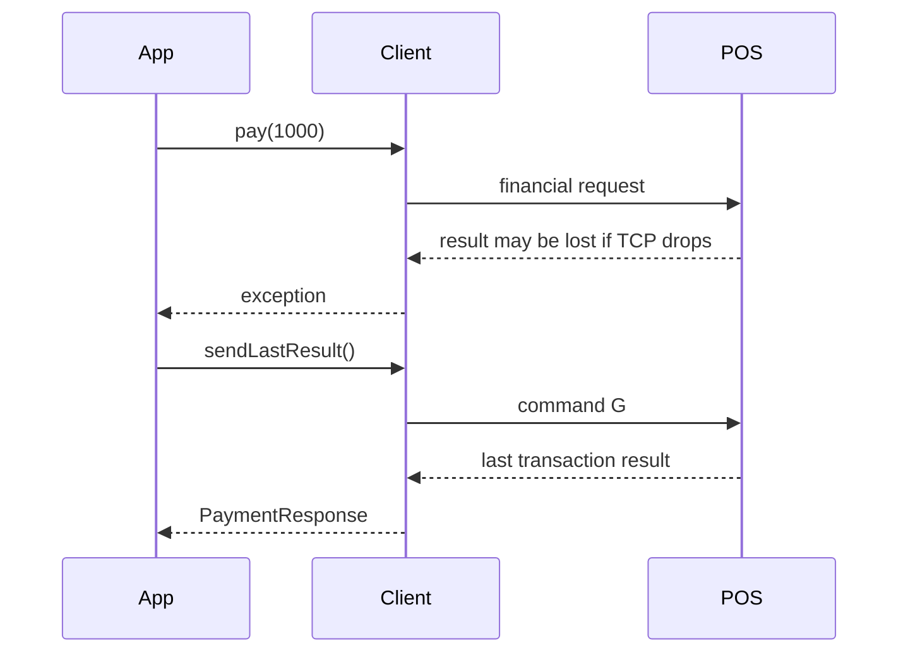

# Recovery

Recovery centers on command `G`, exposed as `sendLastResult()`.

::: steps
1. Catch the payment exception.
2. Mark the order as requiring ECR17 reconciliation.
3. Reconnect if needed.
4. Call `sendLastResult()`.
5. Compare amount, STAN, auth code, and terminal data to the order.
6. Store a single final outcome.
:::

::: callout danger "Gotcha"
Do not use retry middleware around financial commands unless it is aware of ECR17 money safety. Generic HTTP or queue retry policies can create duplicate charges.
:::
