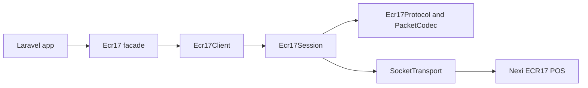

# laravel-ecr17

`padosoft/laravel-ecr17` drives Italian ECR17 / Protocollo 17 POS terminals over TCP from PHP and Laravel.

::: callout info "Project scope"
The package implements framing, LRC validation, ACK/NAK retransmission, response parsing, progress callbacks, receipt streaming, Laravel service provider wiring, and a demo debug console.
:::

::: grids
::: grid
## Install

```bash
composer require padosoft/laravel-ecr17
```
:::

::: grid
## Configure

Set `ECR17_HOST`, `ECR17_PORT`, `ECR17_TERMINAL_ID`, and `ECR17_CASH_REGISTER_ID`.
:::

::: grid
## Operate safely

Financial commands are not replayed after a dropped connection. Recover with `sendLastResult()`.
:::
:::

## Command families

| Family | Examples | Notes |
| --- | --- | --- |
| Status | `status()` | Read-only and safe to retry after reconnect. |
| Payments | `pay()`, `payExtended()`, `reverse()` | Never blindly replay after a drop. |
| Pre-auth | `preAuth()`, `incrementalAuth()`, `preAuthClosure()` | Preserve authorization codes. |
| Back office | `closeSession()`, `totals()`, `sendLastResult()` | Used for closure, reconciliation, and recovery. |
| POS UX | `enableEcrPrinting()`, `reprint()`, `vas()` | Receipt and value-added service support. |

## System shape



::: callout warning "Blocking workflow"
Commands are synchronous. In production, run long payment interactions from queues, workers, Octane, or another controlled background execution path.
:::
