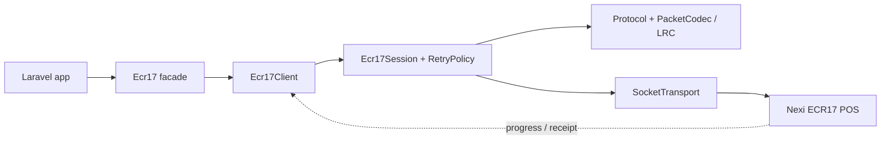

# laravel-ecr17


> **laravel-ecr17 speaks the Italian ECR17 / "Protocollo 17" amount-exchange protocol to Nexi Group POS terminals over TCP — straight from your Laravel app.**
> A framework-free protocol core (framing, LRC, the ACK/NAK handshake with retransmission and timeouts, every command builder and every response parser) wrapped in a thin Laravel layer — with a money-safety invariant that guarantees a dropped connection can never double-charge a card.

::: callout info "New here? Read this page top to bottom" icon:compass
In five minutes you'll know exactly what this package is, the problem it solves, why it beats hand-rolling a socket client, and where to click next. Every other page goes deeper — this one gives you the whole picture.
:::

---

## What it is — in one minute

To take a card payment from a cash register (ECR) you have to talk to the payment terminal (POS) in its own language. In Italy that language is **ECR17 / "Protocollo 17"**, the amount-exchange protocol spoken over TCP/IP by **Nexi Group** terminals. The ECR frames an application message (`STX … ETX LRC`), the terminal ACK/NAKs it, streams progress and receipt lines, and finally returns the transaction result.

Getting that right by hand is deceptively hard: byte framing, the LRC checksum, ACK/NAK retransmission with timeouts, half-open sockets between transactions, and — most dangerously — what to do when the line drops *after* the card was charged but *before* the result arrived.

`laravel-ecr17` implements the **full protocol** for you:

- **Every ECR17 command** — status, pay, extended pay, reverse, pre-auth, incremental auth, pre-auth closure, card verification, close session, totals, send-last-result, ECR printing, reprint, VAS, plus tokenization (`U`).
- **A money-safe session** — a financial command is **never** blindly re-sent after a drop; recover a lost result with `sendLastResult()` (`G`). Proactive reconnection keeps a payment from ever starting on a dead socket.
- **Real-time streaming** — progress messages and receipt lines surface through events/callbacks as the cardholder interacts with the terminal.

> *In one line: the complete, money-safe ECR17 protocol stack for PHP & Laravel — pure-PHP core, thin Laravel wrapper, tested 1:1 against its React Native sibling.*

---

## The problem it solves

Every team integrating a Nexi POS over Protocollo 17 hits the same wall. Here is the gap this package closes.

| Without laravel-ecr17 | With laravel-ecr17 |
|---|---|
| You hand-build `STX … ETX LRC` framing and the LRC checksum — and get an off-by-one wrong in production. | A unit-tested codec frames and validates every packet, with selectable LRC modes (`stx \| std \| noext \| stx_noext`). |
| You bolt retransmission onto raw `fsockopen` and hope the timeouts are right. | The ACK/NAK handshake, retransmission count and per-phase timeouts are built in and configurable. |
| A dropped line after the charge makes you guess: re-send and risk a **double charge**, or skip and lose the result. | A locked invariant: financial commands are never replayed; recover the real outcome with `sendLastResult()` (`G`). |
| Nexi terminals silently close the socket between transactions; your next payment fails on a half-open connection. | A non-destructive liveness probe reconnects **before** sending, so a payment never starts on a stale socket. |
| Progress ("INSERIRE CARTA") and receipt lines are buried in the byte stream. | Wire `onProgress` / `onReceiptLine` / `onConnectionStateChange` callbacks for real-time UX. |
| Your protocol logic is tangled into Laravel and impossible to unit-test in isolation. | A **framework-free core** (`Padosoft\Ecr17\Protocol\|Response\|Session`) tested standalone; Laravel is a thin wrapper. |
| No reference behavior to test against — you find out it's wrong at the till. | Tested against scripted scenarios (Pest), ported 1:1 from the React Native sibling's GoogleTest suite. |

---

## Who it's for

::: grids
  ::: grid
    ::: card "Italian retail & ecommerce on Laravel" icon:store
    Taking card payments through a Nexi POS at the counter? Call `Ecr17::pay()` and let the package own framing, handshakes, reconnection and money-safety.
    :::
  :::
  ::: grid
    ::: card "POS / cash-register integrators" icon:plug
    Building till software or a payment bridge? A clean command/response API covers the whole ECR17 command set — payments, pre-auth, totals, VAS, tokenization.
    :::
  :::
  ::: grid
    ::: card "Teams that need money-safety guarantees" icon:shield-check
    Where a double-charge is unacceptable, the no-blind-replay invariant and `sendLastResult()` recovery are locked by tests, not left to your `try/catch`.
    :::
  :::
  ::: grid
    ::: card "Cross-platform product teams" icon:smartphone
    Shipping the same protocol on mobile? The sibling `react-native-ecr17-protocol` is the behavioral source of truth — identical byte layouts and test scenarios.
    :::
  :::
:::

---

## Why it's different — the moats

These are the things you **won't** get from a quick `fsockopen` wrapper or a closed vendor SDK.

::: grids
  ::: grid
    ::: card "Money-safe by invariant, not by hope" icon:banknote
    A financial command is **never** blindly re-sent after a drop — only read-only/idempotent commands are. The rule lives in `Session\RetryPolicy` and is locked by its tests, so a refactor can't silently re-enable a double-charge.
    :::
  :::
  ::: grid
    ::: card "Proactive reconnection" icon:refresh-cw
    ECR17/Nexi terminals close the TCP socket between transactions. A non-destructive liveness probe runs before every command and reconnects proactively — a payment never begins on a stale, half-open socket.
    :::
  :::
  ::: grid
    ::: card "Framework-free protocol core" icon:box
    `Padosoft\Ecr17\Protocol\|Response\|Session` is pure PHP, unit-tested in isolation. Laravel is a thin convenience layer — you can drive the client with your own transport, no framework required.
    :::
  :::
  ::: grid
    ::: card "The complete command set" icon:list-checks
    Status, pay, extended pay, reverse, pre-auth, incremental, pre-auth closure, verify card, close session, totals, send-last-result, ECR printing, reprint, VAS — and optional tokenization (`U`) on payments, pre-auth and verify.
    :::
  :::
  ::: grid
    ::: card "Recovery built in (command G)" icon:life-buoy
    Lost the result to a network blip after the card was charged? `sendLastResult()` (`G`) re-fetches the terminal's last outcome — no re-prompt, no re-charge, no guesswork.
    :::
  :::
  ::: grid
    ::: card "1:1 ported, behavior-pinned tests" icon:git-compare
    The protocol and test suite are ported 1:1 from the React Native / Nitro sibling, the behavioral source of truth — so PHP and mobile agree on every byte layout, offset and money-safety rule.
    :::
  :::
  ::: grid
    ::: card "Configurable, env-driven" icon:sliders-horizontal
    Host, port, terminal & ECR ids, LRC mode, auto-reconnect, connection/response/ACK timeouts, retry count/delay and receipt-drain window — all overridable via `config/ecr17.php` or `.env`.
    :::
  :::
  ::: grid
    ::: card "Real-time progress & receipts" icon:activity
    `onProgress`, `onReceiptLine` and `onConnectionStateChange` callbacks stream the live cardholder journey and receipt text so your UI never shows a frozen "please wait".
    :::
  :::
:::

---

## See it: the demo debug console

The `demo/` directory ships a small Laravel app with a **React + Tailwind** debug console: configure and connect to a POS, run every command, and watch the behind-the-scenes log on screen and in a file. No `npm`/Vite build needed — it loads React + Tailwind from a CDN.


---

## laravel-ecr17 vs. the alternatives

| Capability | **laravel-ecr17** | Hand-rolled socket client | Closed vendor SDK |
|---|:---:|:---:|:---:|
| Full ECR17 command set (pay, pre-auth, VAS, tokenization…) | ✅ | ➖ | ✅ |
| LRC modes + ACK/NAK retransmission & timeouts built in | ✅ | ❌ | ✅ |
| Money-safe: no blind replay of financial commands | ✅ | ❌ | ➖ |
| Proactive reconnect before each command | ✅ | ❌ | ➖ |
| Lost-result recovery via `sendLastResult()` (G) | ✅ | ❌ | ➖ |
| Framework-free, unit-testable core | ✅ | ➖ | ❌ |
| Open source, self-owned, MIT | ✅ | ✅ | ❌ |
| Behavior pinned to a cross-platform test suite | ✅ | ❌ | ➖ |

> Legend: ✅ built-in · ➖ partial / DIY / not exposed · ❌ not available.

---

## How it fits together

A command flows from your Laravel app through the facade to the client, which runs the money-safe session over a socket transport to the terminal — and streams progress and receipt lines back as it goes.



The money-safety decision in one rule:

$$
\text{retry-after-drop} = \begin{cases} \text{yes} & \text{if command is read-only / idempotent} \\ \text{no} & \text{if command is financial (recover via } G\text{)} \end{cases}
$$

---

## Start in 30 seconds

::: steps
1. **Install the package**
   ```bash
   composer require padosoft/laravel-ecr17
   php artisan vendor:publish --tag=ecr17-config
   ```

2. **Configure the terminal** (via `config/ecr17.php` or `.env`)
   ```dotenv
   ECR17_HOST=192.168.1.50
   ECR17_PORT=10000
   ECR17_TERMINAL_ID=12345678
   ECR17_CASH_REGISTER_ID=1
   ```

3. **Take a payment**
   ```php
   use Padosoft\Ecr17\Facades\Ecr17;
   use Padosoft\Ecr17\Response\Outcome;

   Ecr17::connect();
   $result = Ecr17::pay(amountCents: 1000, paymentType: 'credit'); // €10.00

   if ($result->outcome === Outcome::Ok) {
       // $result->authCode, $result->pan, $result->stan, ...
   }
   ```
   A payment can block while the cardholder interacts. **In production**, drive it from a queued job or under Octane/Swoole — never block a web request on a live payment.
:::

**[→ Quickstart](/get-started/quickstart)** · **[→ Installation](/get-started/installation)** · **[→ Payments guide](/guides/payments)**

---

## Batteries included for AI-assisted development

This repo ships **AI batteries** — a `CLAUDE.md` working guide, an `AGENTS.md` workflow contract and invocable `.claude/skills/` encoding the protocol facts, the money-safety invariant and the docs-sync discipline. Open the package in Claude Code, Cursor, Copilot or Codex and your agent already knows the house rules.

---

## Where to go next

::: grids
  ::: grid
    ::: card "Money Safety" icon:shield
    Why a financial command is never replayed, and how `sendLastResult()` recovers a lost outcome. **[Read →](/concetti-teoria/money-safety)**
    :::
  :::
  ::: grid
    ::: card "Architecture" icon:boxes
    The framework-free core, the session pipeline and the ADRs behind the design. **[Explore →](/architettura/overview)**
    :::
  :::
  ::: grid
    ::: card "API Reference" icon:code
    Every command builder, the configuration surface and the response object. **[Browse →](/reference/api)**
    :::
  :::
:::

::: callout tip "Package facts" icon:info
Composer `padosoft/laravel-ecr17` · PHP `^8.3` (8.3–8.5) · Laravel 13 · MIT ·
[GitHub](https://github.com/padosoft/laravel-ecr17) · [Packagist](https://packagist.org/packages/padosoft/laravel-ecr17) ·
Mobile sibling: [`react-native-ecr17-protocol`](https://github.com/padosoft/react-native-ecr17-protocol)
:::
